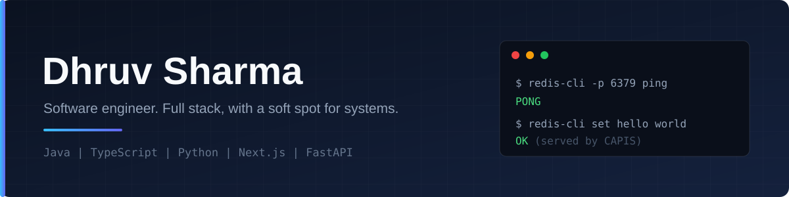

  

<h3 align="center">Full-stack engineer who likes opening the black box.</h3>

  
  
  

I build full-stack products, then dig into the systems underneath them. To understand Redis, I wrote a Redis-compatible server in Java from scratch. In 2026 I led a small team of interns shipping two production Next.js and Supabase apps.

B.E. in Computer Engineering, SVIT Vasad (GTU), 2022 to 2026. Based in Gujarat, India.

## At a glance

- **37 commands, ~60K to 67K req/s**: CAPIS, my Redis clone, runs on a single thread and works with the stock `redis-cli`, on an old Core i3.
- **~30% faster queries**: moved a production app from MongoDB to MySQL at Pintube.
- **Led 4 to 6 interns** on two production apps, owning architecture, backend and data layers.

## Now

- Building **Markblox**, a Markdown-native CMS, in the open.
- Learning **system design** and **cloud technologies**.
- Looking for **software engineering roles**, backend or full-stack.

---

## Selected work

### Systems

**[CAPIS](https://github.com/MrD0511/capis)**: a Redis-compatible in-memory key-value store written from scratch in Java (`java.nio`, RESP).
Transactions (MULTI/EXEC), pipelining, TTL expiry, and hand-written LRU and LFU eviction.

### Products

**[Markblox](https://early.markblox.com)**: a Markdown-native CMS. Writers edit like a document, developers read content through a framework-agnostic API.
Tiptap editor with custom blocks, API keys, webhooks, rotating-refresh-token auth. *Next.js 16, TypeScript, Node.js, MongoDB.*

**[CipherChats](https://cipherchats.vercel.app)**: real-time chat with end-to-end encryption. One key pair per conversation, private keys never leave the client, offline messages are queued and resent. *React, FastAPI, WebSockets, MongoDB.*

**[Astro AI](https://astroai.sharmadhruv.tech)**: an AI astrologer that keeps all user data in the browser. The backend only runs inference and stores nothing. *FastAPI, React, Gemini API.*

### Smaller projects

- **[Deck](https://github.com/MrD0511/deck)**: a Dockerfile generator.
- **[Super Me](https://github.com/MrD0511/Super_Me)**: a platformer game remake.

### How CAPIS handles a request

The whole server is one process and one thread. The event loop reads bytes, the parser turns them into commands, and the cache handles eviction and expiry.

---

## Experience

**Full Stack Developer Intern**, Agilescript Innovations · Jan to Apr 2026
- Led 4 to 6 interns across two production Next.js and Supabase apps.
- Owned architecture, backend and data layers: an RBAC admin panel, a generic database manager and the auth setup.

**Full Stack Intern**, Pintube (remote, UK-based) · Mar to Sep 2024
- Built a full-stack app on Angular, Node.js and MongoDB, then migrated it to MySQL, cutting complex-query latency by about 30%.
- Reduced latency in the background music playback feature by 30 to 35%.

---

## Stack

  

Also comfortable with REST APIs, WebSockets, JWT auth, and data structures and algorithms.

---

  

  Want to talk backend work, systems or an internship? <a href="https://linkedin.com/in/dhruvsharma005">LinkedIn</a> is the quickest way.

