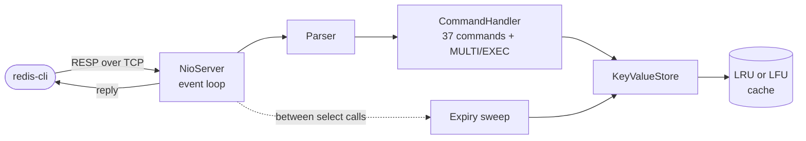

  

  
  
  

I build full-stack products, and lately I've been digging into the systems underneath them. To see how Redis works, I wrote a Redis-compatible server in Java from scratch. In 2026 I led a small team of interns on two production Next.js and Supabase apps.

B.E. in Computer Engineering, SVIT Vasad (GTU), 2022 to 2026. Based in Gujarat, India.

---

## Selected work

| Project | What it is | Built with |
| --- | --- | --- |
| **[CAPIS](https://github.com/MrD0511/capis)** | A Redis-compatible in-memory key-value store written from scratch. Works with `redis-cli`. 37 commands, transactions, pipelining, hand-written LRU and LFU eviction, TTL expiry. About 60K to 67K requests/sec on an old Core i3. | Java, `java.nio`, RESP |
| **[Markblox](https://early.markblox.com)** | A Markdown-native CMS. Writers edit like a document, developers read content through a framework-agnostic API. Tiptap editor with custom blocks, API keys, webhooks, rotating-refresh-token auth. | Next.js 16, TypeScript, Node.js, MongoDB |
| **[CipherChats](https://cipherchats.vercel.app)** | A real-time chat app with end-to-end encryption. One key pair per conversation, private keys stay on the client, offline messages are queued and resent. | React, FastAPI, WebSockets, MongoDB |
| **[Astro AI](https://astroai.sharmadhruv.tech)** | An AI astrologer that keeps all user data in the browser. The backend only runs inference and stores nothing. | FastAPI, React, Gemini API |
| **[Deck](https://github.com/MrD0511/deck)** | A Dockerfile generator. | |
| **[Super Me](https://github.com/MrD0511/Super_Me)** | A platformer game remake. | |

### How CAPIS handles a request

The whole server is one process and one thread. The event loop reads bytes, the parser turns them into commands, and the cache handles eviction and expiry.

---

## Experience

| When | Role | What I did |
| --- | --- | --- |
| Jan to Apr 2026 | **Full Stack Developer Intern**, Agilescript Innovations | Led 4 to 6 interns on two production Next.js and Supabase apps. Owned the architecture, backend and data layers: an RBAC admin panel, a generic database manager and the auth setup. |
| Mar to Sep 2024 | **Full Stack Intern**, Pintube (remote, UK-based) | Built a full-stack app on Angular, Node.js and MongoDB, then moved it to MySQL, cutting complex-query latency by about 30%. Cut latency in the background music playback feature by 30 to 35%. |

---

## Stack

  

Also comfortable with REST APIs, WebSockets, JWT auth, and data structures and algorithms. Currently learning system design and cloud technologies.

---

  Want to talk about backend work, systems or an internship? <a href="https://linkedin.com/in/dhruvsharma005">LinkedIn</a> is the quickest way.

